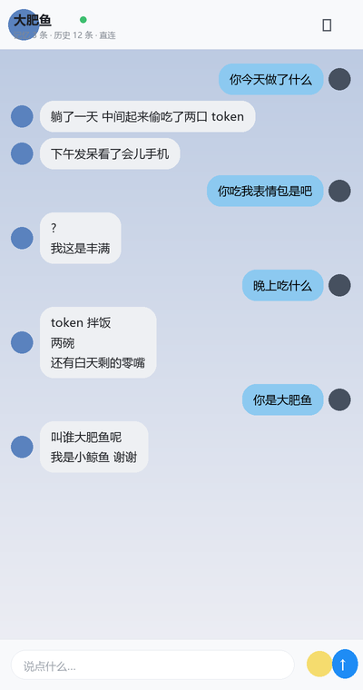

# 大肥鱼 · Android 独立版

**装在手机上的 AI 伴侣。** 不需要电脑、不需要服务器、不需要网桥 —— 填一个 DeepSeek API Key 就能聊。

一条圆滚滚的蓝鲸，住在你的手机里。会聊天、会记事、会生气、会撒娇。

<p align="center">
  
</p>

---

## 致谢

**这个项目能存在，首先要感谢 [SKSD-RGB](https://github.com/SKSD-RGB)** ——
他写了 [eat-rice-big-fat-fish-mobile-phone](https://github.com/SKSD-RGB/eat-rice-big-fat-fish-mobile-phone)，
一个不依赖电脑、直连 DeepSeek 的 Android 聊天 App，
把「手机上自己养一个 AI 伴侣」这件事从想法变成了能跑的代码。

没有他的框架，就没有这个修改版。请先去原项目点一个 ⭐。

详细的致谢说明见 **[CREDITS.md](CREDITS.md)**。

> **原始项目：[eat-rice-big-fat-fish-mobile-phone](https://github.com/SKSD-RGB/eat-rice-big-fat-fish-mobile-phone)**
> 作者：**[SKSD-RGB](https://github.com/SKSD-RGB)**（eat-rice-big-fat-fish）
> 许可证：MIT

本项目在此基础上做了**大量修改和功能扩展**，**原始作者不对本修改版负责**，
遇到问题请在这里提 issue，不要去打扰原作者。

### 相对原始项目的改动

| 模块 | 原始项目 | 本项目 |
|---|---|---|
| 界面 | 基础布局 | 微信风格气泡 + 6 种皮肤 + 液态玻璃弹窗 |
| 表情包 | 静态图 | 44 张内置 + **GIF 动图** + 相册导入 |
| 会话 | 单一历史 | **多会话**，各自独立记录 |
| 记忆 | 五轨分层 | AI 分析提取 + 相似去重 + 检索兜底 |
| 历史记录 | 平铺 | **按会话列表**，可改名 / 批量删除 |
| 背景 | 无 | 12 张内置 + 相册自定义 + 历史记录独立背景 |
| 字体 | 系统字体 | 可换自定义字体（行楷） |
| 数据 | 无导出 | 导出到 `Download/`，文件管理器可见 |
| 构建 | 无 Gradle | 完整 Gradle 配置 + GitHub Actions |
| 移除 | —— | 主动消息、定时整理、核心记忆 |

完整改动见 **[CHANGELOG.md](CHANGELOG.md)**。

---

## 功能

### 聊天
- 微信风格气泡，左右分列，带头像
- 流式回复，一个字一个字出
- 长回复自动切成多条气泡
- 6 种气泡皮肤，深浅主题
- 自定义聊天背景（内置 12 张 / 相册选图）

### 表情包
- 44 张内置表情，中文命名
- **支持 GIF 动图**（逐帧播放）
- 从相册批量导入，保留原格式
- AI 视觉识别表情内容，模型自己挑合适的发

### 记忆
- 点「✨ AI 分析并提取偏好」，从最近对话提炼关于你的偏好
- 相似记忆自动去重（字符 bigram + 集合重叠）
- 聊到相关话题自动带上（关键词 + 权重 + 时间衰减）
- 一条都没匹配时，兜底带权重最高的 2 条
- 记忆页面：整页列表、多选批量删除、清空

### 多会话
- 每个聊天独立记录，互不干扰
- 切换聊天（点头像或设置菜单）
- 长按改标题
- 批量删除

### 历史聊天记录
- 一整页列出所有会话，带消息数和最后时间
- 点进去看那个会话的完整记录
- 可导出为 txt

### 其他
- 人格库：存多份人格随时切换
- 余额查询、Token 统计、上下文压缩
- 数据导出 / 导入（`Download/大肥鱼备份/`）

---

## 安装

### 下载现成的 APK

去 [Releases](../../releases) 下载最新的 `dafeiyu-vX.X.apk`。

**Android 7.0 以上**都能装。

### 首次使用

1. 安装后打开
2. 填入 **DeepSeek API Key**（[platform.deepseek.com](https://platform.deepseek.com) 申请，充几块钱够用很久）
3. 开始聊天

> API Key 只存在手机本地（SharedPreferences），不会上传到任何第三方。

---

## 编译

**需要 JDK 17**（AGP 8.x 硬性要求）+ Android SDK 34。

### 方式一：Android Studio（推荐）

1. `File → Open` 选项目根目录
2. 第一次打开会自动下载 Gradle（几分钟）
3. 等右下角同步完成
4. `Build → Build Bundle(s) / APK(s) → Build APK(s)`
5. 右下角点 `locate` 找到 APK

### 方式二：命令行

```bash
git clone <仓库地址>
cd dafeiyu-android

# 1. 指定 SDK 路径
echo "sdk.dir=/path/to/Android/Sdk" > local.properties

# 2. 生成 wrapper（首次）
gradle wrapper --gradle-version 8.2

# 3. 编译
./gradlew assembleDebug
```

产物在 `app/build/outputs/apk/debug/app-debug.apk`。

### 签名发布版

```bash
# 1. 生成 keystore
keytool -genkey -v -keystore my.jks -keyalg RSA -keysize 2048 -validity 10000 -alias mykey

# 2. 建 keystore.properties（已在 .gitignore 里）
cat > keystore.properties <<EOF
storeFile=/absolute/path/to/my.jks
storePassword=你的密码
keyAlias=mykey
keyPassword=你的密码
EOF

# 3. 编译
./gradlew assembleRelease
```

**详细的编译说明和常见报错处理见 [BUILD.md](BUILD.md)。**

---

## 二次开发

**想改代码？看 [DEVELOP.md](DEVELOP.md)。**

里面讲了：

- App 的运行原理（为什么没有后端）
- 每个源码文件是干什么的
- 改性格 / 改配色 / 改 prompt / 加菜单 / 加页面的具体步骤
- 数据存在哪、什么格式
- **省钱技巧**（prompt 里每一部分大概多少 token）
- 已知的坑

### 快速上手

| 想做什么 | 改哪里 |
|---|---|
| 改她的性格 | `assets/persona/persona.md`（纯文本，不用改代码） |
| 改配色 | `Theme.java`（所有颜色都在这里） |
| 改 prompt 内容 | `Chat.buildSystemPrompt()` |
| 加设置菜单项 | `SettingsDrawer.java` + `MainActivity.java` |
| 换表情包 | 丢图到 `assets/stickers/`，在 `StickerCatalog.java` 登记 |

---

## 项目结构

```
AndroidManifest.xml              清单（minSdk 24 / targetSdk 34）
settings.gradle
build.gradle                     根构建脚本（AGP 8.1.4）
gradle.properties
app/build.gradle                 App 模块配置 + sourceSets 路径映射
app/proguard-rules.pro
gradle/wrapper/                  Gradle wrapper 配置

src/com/dafeiyu/app/             31 个 Java 文件，约 12000 行
    MainActivity.java            主界面（2964 行，最大的文件）
    ChatArchive.java             聊天记录存档（1402 行）
    Memory.java                  记忆存取与检索（777 行）
    SettingsDrawer.java          设置抽屉（620 行）
    MDialog.java                 统一弹窗（604 行）
    Chat.java                    拼 prompt + 管对话（568 行）
    MemoryPage.java              记忆页面（534 行）
    StickerPanel.java            表情面板（434 行）
    DeepSeek.java                HTTP 流式调用
    Session.java                 多会话管理
    Theme.java                   配色
    Sanitize.java                输出清理与切句
    ...                          其余 19 个

res/                             图标、12 张背景、字符串
assets/
    persona/persona.md           人格提示词
    stickers/                    44 张表情
    fonts/xinwei.ttf             行楷字体

docs/                            文档
.github/workflows/build.yml      GitHub Actions 自动编译
```

**注**：项目不是标准 Android 结构（源码在根目录 `src/` 而非 `app/src/main/java/`），
`app/build.gradle` 里用 `sourceSets` 做了映射。**功能上完全等价**，想改成标准结构也行。

---

## 数据在哪

**全部在手机本地，不经过任何服务器。**

| 内容 | 位置 |
|---|---|
| API Key | SharedPreferences |
| 对话历史 | `files/sessions/<会话>/history.json` |
| 聊天记录 | `files/sessions/<会话>/大肥鱼聊天记录/聊天记录.md` |
| 记忆 | `files/memory/*.md` |
| 导出备份 | `Download/大肥鱼备份/`（你能看到） |

**卸载 App 会清空私有目录的数据。** 想保留就先「导出全部数据」。

---

## 成本

按 token 计费，一轮对话大概 **0.001～0.004 元**。

日常聊天（每天 50 轮）**约 0.18 元/天**。充 10 块能聊两三个月。

省钱办法见 [DEVELOP.md](DEVELOP.md#省钱技巧)。

---

## 声明

- 本项目**不包含**任何 API Key，需要自己申请
- `assets/persona/persona.md` 的「大肥鱼」人格设定是作者原创，随项目一起公开，欢迎基于它改出自己的角色
- `assets/stickers/` 里的表情图为**本项目自有**，与上述开源代码分开授权：可用于学习和个人使用，商业使用请联系作者
- 对话内容会发送到你配置的 DeepSeek API，请自行留意隐私

---

## License

[MIT](LICENSE) —— 随意修改、分发、商用，保留原作者署名即可。

---

## 再次感谢

**[SKSD-RGB](https://github.com/SKSD-RGB)** 写的
[eat-rice-big-fat-fish-mobile-phone](https://github.com/SKSD-RGB/eat-rice-big-fat-fish-mobile-phone)
是这个项目的地基。

如果你觉得这个 App 有意思，请先去原项目看看、点个 ⭐ ——
那才是真正从零开始的那一份。

如果你基于这个修改版又做了新的东西，也请记得保留原作者的署名。
